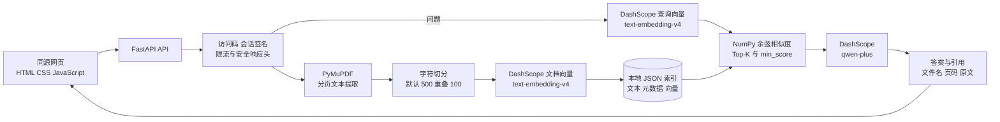
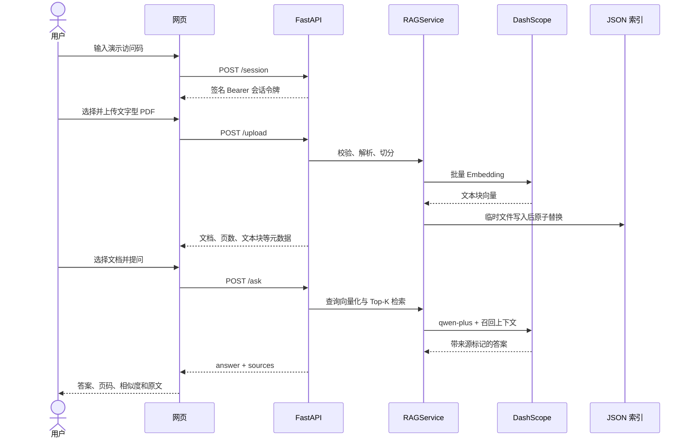

# 智能文档问答系统

一个面向技术面试演示和代码 Review 的轻量级 PDF RAG 项目。用户通过访问码进入同源网页，上传文字型 PDF 后，服务完成文本提取、重叠切分、DashScope Embedding、NumPy 余弦相似度 Top-K 检索，并由 `qwen-plus` 基于召回原文生成带页码引用的答案。

本项目刻意保持实现透明：它使用进程内 NumPy 线性检索和本地 JSON 索引，不使用向量数据库，也没有生产级吞吐或性能数据。

## 功能

- 原生 HTML/CSS/JavaScript 单页界面，由 FastAPI 同源提供。
- 文字型 PDF 上传、PyMuPDF 分页提取和可配置重叠切分。
- `text-embedding-v4` 批量向量化。
- NumPy 余弦相似度排序、Top-K 和最低相关度过滤。
- `qwen-plus` 文档问答、引用文件名、页码、相似度和原文展示。
- HMAC 签名演示会话、会话级文档隔离和内存滑动窗口限流。
- JSON 索引原子替换、错误信息脱敏、安全响应头。
- pytest 自动化测试；外部模型调用全部使用 Mock。

## 技术栈

| 层次 | 实现 |
| --- | --- |
| 后端 | Python 3.13、FastAPI、Uvicorn、Pydantic |
| PDF 解析 | PyMuPDF |
| Embedding | DashScope OpenAI 兼容接口、`text-embedding-v4` |
| 检索 | NumPy 余弦相似度、进程内全量排序 |
| 生成模型 | DashScope OpenAI 兼容接口、`qwen-plus` |
| 索引持久化 | `data/rag_index.json` |
| 前端 | 原生 HTML/CSS/JavaScript |
| 测试 | pytest、FastAPI TestClient、模型 Mock |
| 容器 | Docker、Docker Compose |

## RAG 系统架构



关键边界：

- 上传的 PDF 字节只在请求处理中使用，不保存原文件。
- JSON 索引会保存提取出的原文、页码、文档元数据和完整向量，因此仍应视为敏感数据。
- 查询向量与所有候选向量使用 NumPy 逐一计算余弦相似度，再排序取 Top-K；没有 ANN 索引或向量数据库。
- `owner_id` 来自签名会话，同一进程内不同演示会话默认看不到彼此的文档。

## PDF 上传与问答流程



默认上传参数为 `chunk_size=500`、`overlap=100`。网页问答固定使用 `top_k=3` 和 `min_score=0.25`。若没有结果达到阈值，接口返回 `mode: "insufficient_context"` 和“根据已上传文档无法确定”，不会继续调用聊天模型。

## 项目结构

```text
.
├── main.py                       # FastAPI 路由、安全响应头和依赖装配
├── rag_service.py                # PDF、切分、Embedding、检索、问答、JSON 索引
├── security.py                   # 访问码、签名会话和单进程限流
├── static/                       # 同源网页
├── tests/                        # Mock 自动化测试
├── reports/                      # 验收和公开检查报告
├── Dockerfile
├── compose.yaml
├── .dockerignore
├── .env.example
├── requirements.txt
└── requirements-dev.txt
```

## 安装与运行

### Windows PowerShell

项目已验证的本地环境为 Python 3.13.9。

```powershell
cd "E:\interview-demo"
py -3.13 -m venv .venv
.\.venv\Scripts\python.exe -m pip install -r requirements.txt
Copy-Item .env.example .env
```

编辑 `.env`，至少填写：

```dotenv
DASHSCOPE_API_KEY=your-key-here
DEMO_ACCESS_TOKEN=replace-with-a-random-value-at-least-16-characters
```

启动服务：

```powershell
.\.venv\Scripts\python.exe -m uvicorn main:app --host 127.0.0.1 --port 8000
```

打开：

- 网页：`http://127.0.0.1:8000`
- Swagger：`http://127.0.0.1:8000/docs`
- 健康检查：`http://127.0.0.1:8000/health`

不要使用 `--reload`、`0.0.0.0` 或真实文档进行公开演示，除非已经明确配置网络边界、访问码和数据处理策略。

## API 接口

除 `/`、`/health`、`/session` 和静态文件外，其余接口都需要：

```http
Authorization: Bearer <session-token>
```

| 方法 | 路径 | 说明 |
| --- | --- | --- |
| `GET` | `/` | 网页入口 |
| `GET` | `/health` | 模型配置和访问控制状态，不验证远端模型可用性 |
| `POST` | `/session` | 使用演示访问码换取有时效的签名会话令牌 |
| `GET` | `/documents` | 列出当前会话拥有的文档索引 |
| `POST` | `/upload` | 上传文字型 PDF，解析、切分并建立向量索引 |
| `POST` | `/search` | 对当前会话文档执行 Top-K 相似度检索 |
| `POST` | `/ask` | 检索后调用聊天模型并返回答案和 `sources` |
| `DELETE` | `/documents/{document_id}` | 删除当前会话拥有的指定索引 |

`POST /session`：

```json
{
  "access_code": "your-demo-access-token"
}
```

`POST /ask`：

```json
{
  "question": "这份文档的核心结论是什么？",
  "top_k": 3,
  "document_id": "document-id-from-upload",
  "min_score": 0.25,
  "use_rag": true
}
```

主要响应模式：

- `rag`：存在可靠检索来源，返回模型答案和 `sources`。
- `insufficient_context`：未达到相关度阈值，不调用聊天模型。
- `general`：仅当 API 客户端显式传入 `use_rag=false` 时启用，不是网页默认行为。

常见状态码：`400` 参数或 PDF 错误、`401` 未登录或令牌失效、`404` 文档不存在、`413` 文件过大、`429` 超出请求限额、`502` 上游模型调用失败、`503` 未配置模型服务。

## 环境变量

`.env.example` 只包含空值、公开默认值和占位符。`.env` 被 Git 与 Docker 构建上下文排除。

| 变量 | 默认值 | 说明 |
| --- | --- | --- |
| `DASHSCOPE_API_KEY` | 无 | 必填；仅服务端读取，禁止提交 |
| `DASHSCOPE_BASE_URL` | DashScope 兼容端点 | OpenAI 兼容 API 地址 |
| `EMBEDDING_MODEL` | `text-embedding-v4` | Embedding 模型 |
| `CHAT_MODEL` | `qwen-plus` | 聊天模型 |
| `EMBEDDING_BATCH_SIZE` | `10` | 每次 Embedding 请求的文本块数量 |
| `MAX_PDF_BYTES` | `10485760` | 服务端 PDF 大小上限 |
| `RAG_MIN_SCORE` | `0.25` | 默认最低余弦相似度 |
| `DEMO_ACCESS_TOKEN` | 自动生成到本地忽略文件 | 公开或容器运行时必须显式设置，至少 16 字符 |
| `DEMO_SESSION_TTL_MINUTES` | `240` | 会话有效期，代码最少按 15 分钟处理 |
| `DEMO_REQUESTS_PER_MINUTE` | `60` | 每会话总请求限额 |
| `DEMO_UPLOADS_PER_HOUR` | `5` | 每会话上传限额 |
| `DEMO_ASKS_PER_MINUTE` | `20` | 每会话问答限额 |
| `DEMO_LOGINS_PER_10_MINUTES` | `10` | 每客户端地址登录尝试限额 |
| `LOG_LEVEL` | `INFO` | Python 日志级别 |
| `PORT` | `8000` | Docker 启动端口；本地 CLI 可自行指定 |

## 自动化测试

安装开发依赖并运行：

```powershell
.\.venv\Scripts\python.exe -m pip install -r requirements-dev.txt
.\.venv\Scripts\python.exe -B -m pytest
```

当前测试覆盖会话签名、防篡改、限流、会话隔离、PDF 错误、切分、余弦检索、索引持久化、来源返回、错误脱敏和主要 API 流程。外部 Embedding 和聊天补全均被 Mock，不会产生模型费用。

受控的单文档真实验收记录见 [`reports/c1_acceptance_report.md`](reports/c1_acceptance_report.md)。该记录用于证明链路可运行，不是性能基准。

## Docker 部署配置

### Docker

```bash
docker build -t interview-demo-rag .
docker volume create interview-demo-data
docker run --rm \
  --name interview-demo-rag \
  -p 127.0.0.1:8000:8000 \
  --env-file .env \
  -v interview-demo-data:/app/data \
  interview-demo-rag
```

### Docker Compose

```bash
docker compose up --build
```

镜像使用非 root 用户；Compose 进一步启用只读根文件系统、`no-new-privileges` 和 capability 丢弃。`data` 使用命名卷持久化。部署到第三方平台前，应在平台密钥管理中设置环境变量，不要上传 `.env`。

## 安全设计

- 使用访问码换取 HMAC-SHA256 签名、有到期时间的 Bearer 会话令牌。
- 访问码使用常量时间比较；访问码和 API Key 不进入前端代码。
- 文档和文本块带 `owner_id`，列表、检索、问答、删除均按会话过滤。
- 上传大小、问题长度、Top-K、相关度和请求频率均有限制。
- 未知内部异常写入服务端日志，客户端只收到脱敏错误信息。
- 响应包含 CSP、`X-Frame-Options`、`nosniff`、`no-referrer` 和 `no-store`。
- 索引在全部 Embedding 成功后写入临时文件，再用 `os.replace` 原子替换。
- 前端使用 `textContent` 显示模型和文档文本，不执行模型返回的 HTML。

## 已知限制

- 只支持可提取文本的 PDF；扫描件需要先 OCR，加密 PDF 不支持。
- JSON 索引不是数据库：应用启动时载入内存，写入时整体序列化，不适合大量文档或多实例并发写入。
- NumPy 检索是 O(N) 线性扫描和全量排序，没有 ANN、分片或 GPU 加速。
- 限流器是单进程内存状态；多个 worker/实例之间不共享计数，签名会话也没有集中式撤销列表。
- 文档隔离基于演示会话，不等同于生产级用户、组织和权限模型。
- 索引包含提取原文和向量；数据卷必须按敏感数据保护和清理。
- 模型调用依赖外部网络、账户额度和供应商可用性，可能产生费用。
- 没有性能基准、负载测试、OCR、流式输出、对话历史、重排序器或可观测性平台。
- 当前仓库未包含自动化公网部署流程，也不会自动创建云资源。

## 公开 Review 边界

公开版本不应包含 `.env`、`.venv`、PDF、`data/rag_index.json`、`data/demo_access_token.txt`、日志、临时目录或任何私人材料。发布前可运行：

```powershell
git status --short
git ls-files -- .env ".venv/**" "*.pdf" data/rag_index.json data/demo_access_token.txt "logs/**" "tmp/**"
git log --oneline --all
```

完整 C2 历史与敏感信息检查结果见 `reports/c2_public_review_report.md`。本阶段只准备本地公开 Review 版本，不创建远程仓库、不 push、不部署公网。
